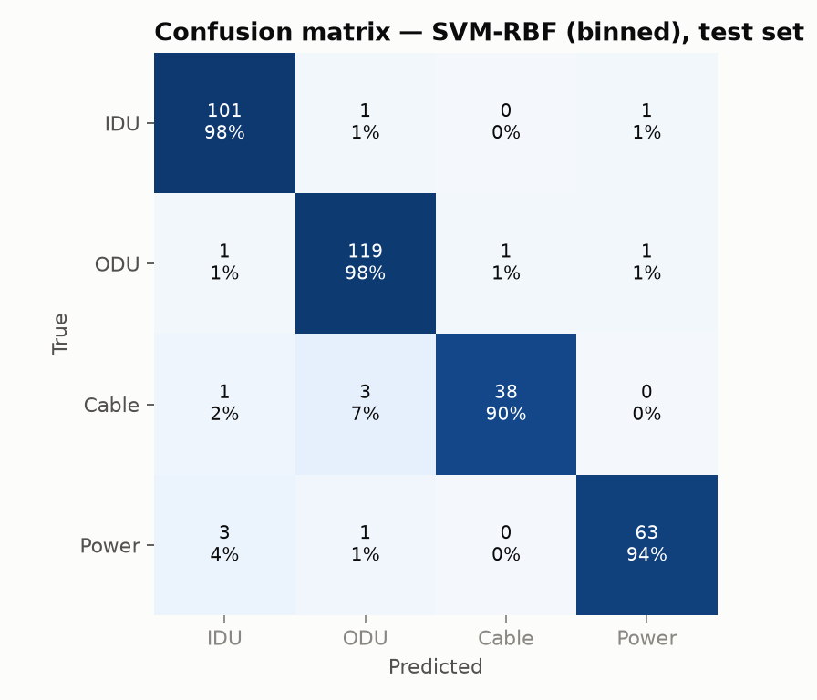
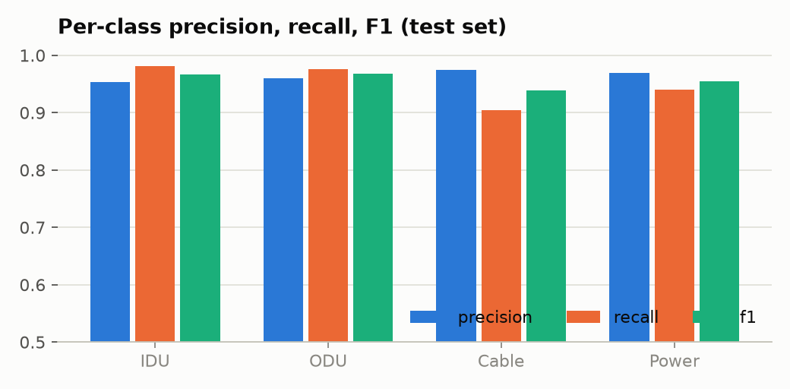
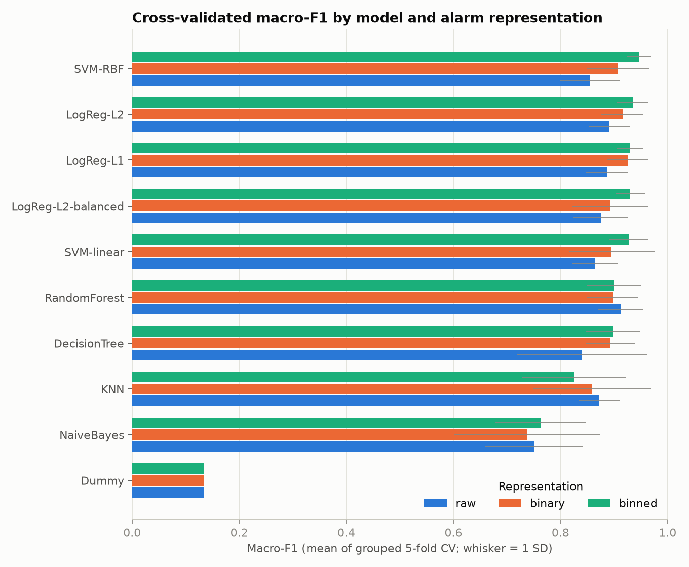
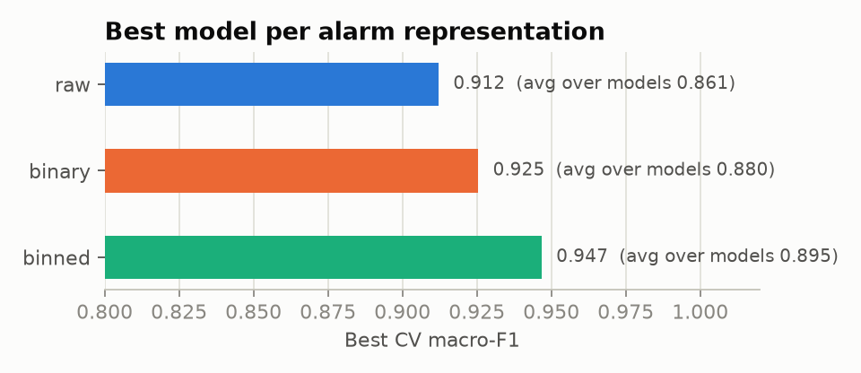
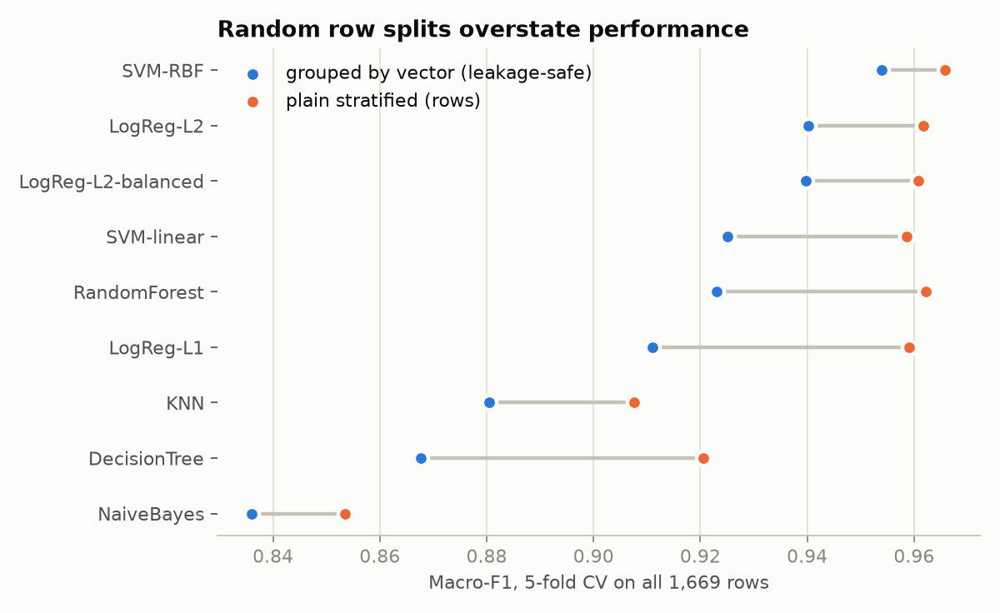
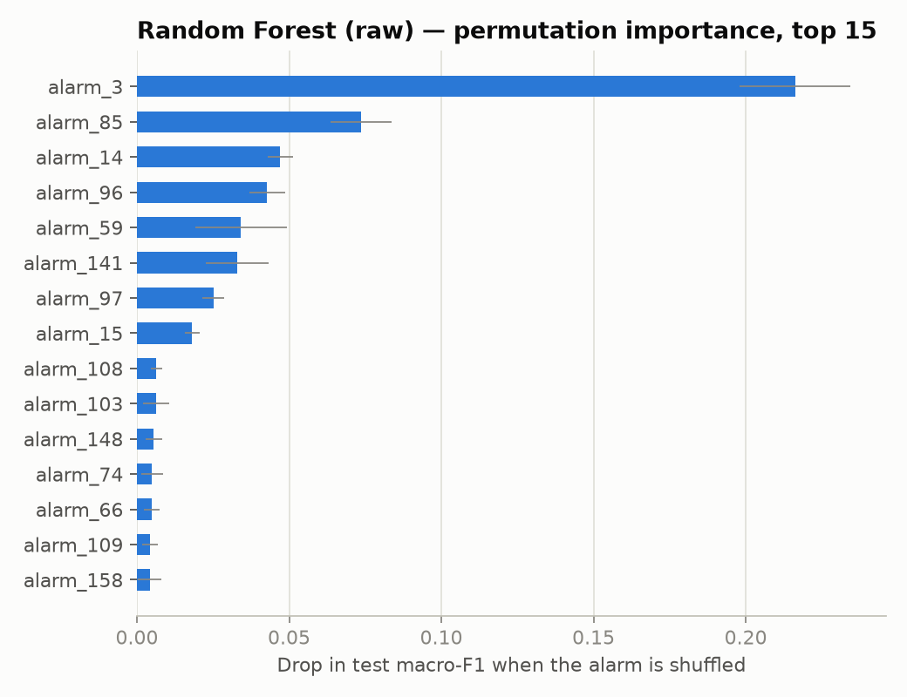
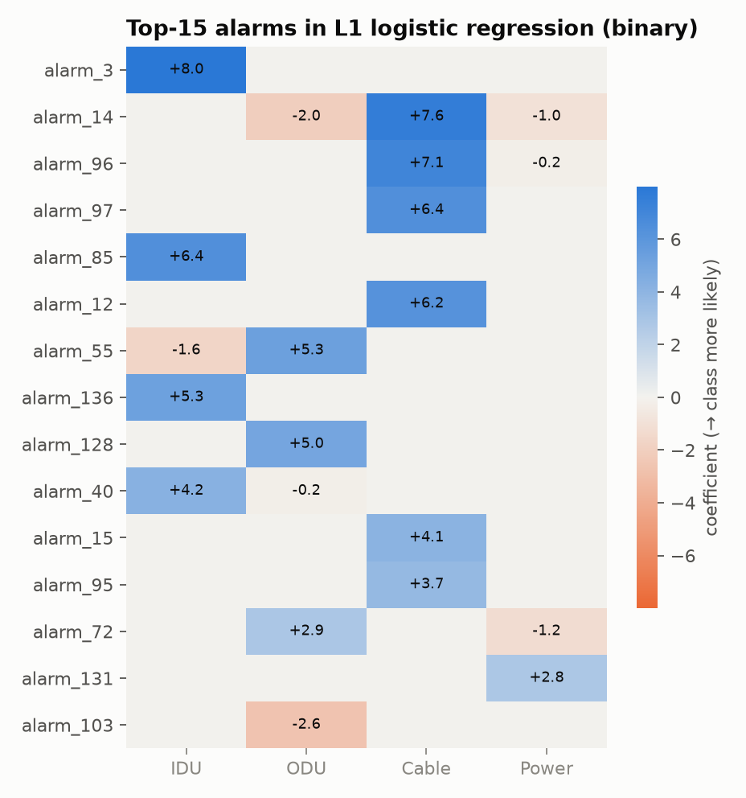

<h1 align="center">Microwave Network Failure Classification</h1>

<p align="center">
  
  
  
  
  
</p>

Identifying the recorded hardware-failure cause (**IDU / ODU / Cable / Power**) of a microwave link from 164 anonymised alarm-duration features (seconds each alarm was active per 15-minute window).

**Best model: SVM with RBF kernel on binned alarm features — 96.1% accuracy, 0.957 macro-F1 on a held-out, leakage-safe test set.**

Dataset: Di Cicco et al., *Machine Learning for Failure Management in Microwave Networks: A Data-Centric Approach*, IEEE TNSM 2024 ([data repo](https://github.com/bonsai-lab-polimi/tnsm2024-data-centric), doi:10.1109/TNSM.2024.3406934).

**Contents:** [Results](#results-at-a-glance) · [Best model](#which-model-is-best-and-why) · [Data protocol](#data-protocol) · [Alarms](#which-alarms-matter) · [Tech stack](#tech-stack) · [Run it](#run-it) · [Layout](#repository-layout) · [Limitations](#limitations)

---

## Results at a glance

| Metric (hold-out test, 334 rows) | Value |
|---|---|
| Accuracy | **0.961** |
| Balanced accuracy | 0.950 |
| Macro-F1 | **0.957** |
| Weighted F1 | 0.961 |
| Grouped 5-fold CV macro-F1 (training data) | 0.947 ± 0.022 |
| Majority-class baseline macro-F1 | 0.134 |



| Class | Precision | Recall | F1 | Support |
|---|---|---|---|---|
| IDU | 0.953 | 0.981 | 0.967 | 103 |
| ODU | 0.960 | 0.975 | 0.967 | 122 |
| Cable | 0.974 | 0.905 | 0.938 | 42 |
| Power | 0.969 | 0.940 | 0.955 | 67 |



Cable is the weakest class (3 of 42 test rows were misread as ODU), but it is also the smallest, so this is the least certain estimate.

---

## Which model is best, and why

**Selected: SVM-RBF (`C=10`, `gamma="scale"`) on binned features.**

1. **Highest cross-validated score.** It ranks first of all 30 model × representation combinations on grouped-CV macro-F1 (0.947), ahead of the next-best LogReg-L2 (0.935).
2. **Most stable on leakage-safe validation.** Its gap between plain and grouped CV is the smallest of the tested models (0.012), so its score depends least on the duplicate-vector issue (see [Data protocol](#data-protocol)).
3. **Strong on every class,** with F1 ≥ 0.938 on all four, including the rare Cable class.
4. **Chosen without looking at the test set.** Selection used CV only; the test set was evaluated once, so the 0.957 macro-F1 is an unbiased estimate.

### Model comparison (grouped 5-fold CV macro-F1, best representation per model)

| Model | Best representation | CV macro-F1 | Test macro-F1 | Test Cable recall |
|---|---|---|---|---|
| **SVM-RBF** | binned | **0.947** | 0.957 | 0.905 |
| LogReg-L2 | binned | 0.935 | 0.948 | 0.833 |
| LogReg-L1 | binned | 0.930 | 0.937 | 0.857 |
| LogReg-L2 (balanced) | binned | 0.930 | 0.957 | 0.881 |
| SVM-linear | binned | 0.928 | 0.951 | 0.929 |
| Random Forest | raw | 0.912 | 0.888 | 0.571 |
| Decision Tree | binned | 0.898 | 0.880 | 0.619 |
| KNN | raw | 0.873 | 0.874 | 0.690 |
| Naive Bayes | binned | 0.763 | 0.859 | 0.976 |
| Dummy (majority class) | any | 0.134 | 0.134 | 0.000 |



**What the comparison shows**
- **Smooth margin models win.** SVMs and logistic regression beat tree ensembles, KNN and Naive Bayes. Random Forest and Decision Tree recall only 52–62% of Cable rows.
- **Binning helps.** The best CV score per representation is 0.947 (binned), 0.925 (binary), 0.912 (raw), and binned also has the best average across models (0.895 vs. 0.880 and 0.861).



**Caveat on the runner-ups.** Some models score higher than the winner on the test set alone (for example SVM-linear on binary features, 0.969). With only 42 Cable rows in the test set, a few points of difference is within noise, which is why selection uses CV and not the test set.

---

## Data protocol

| Item | Value |
|---|---|
| Rows | 1,669 |
| Unique alarm vectors | 1,135 (584 rows share a vector with another row; largest group has 69 rows) |
| Conflicting labels for the same vector | 0 |
| Features | 164 `alarm_*` columns (119 non-constant) |

**Class distribution:** ODU 611 (36.6%), IDU 515 (30.9%), Power 336 (20.1%), Cable 207 (12.4%).

**Protocol**
1. Rows with an identical alarm vector are grouped, so no vector appears in both train and test.
2. Grouped, stratified 80/20 split → 1,335 train / 334 test rows.
3. Grouped 5-fold CV grid search on the training set for 11 models × 3 representations (raw, binary, binned).
4. Select by CV macro-F1.
5. Evaluate the selected model once on the hold-out.

### Leakage check
Because many rows are exact duplicates, a plain random split lets the same vector land in train and test and inflates scores by 0.01–0.05 macro-F1. Grouped splitting prevents this.



### Class imbalance
The classes are moderately imbalanced (ODU is about 3× Cable). Rebalancing was tested and made almost no difference, so the final model uses none.

| Model | Representation | Handling | CV macro-F1 | CV Cable recall |
|---|---|---|---|---|
| LogReg-L2 | binned | none | 0.935 | 0.915 |
| LogReg-L2 | binned | class weights | 0.930 | 0.921 |
| LogReg-L2 | binned | SMOTE (train folds only) | 0.934 | 0.921 |
| Random Forest | raw | none | 0.912 | 0.897 |
| Random Forest | raw | class weights | 0.913 | 0.927 |
| Random Forest | raw | SMOTE (train folds only) | 0.914 | 0.909 |

Metrics are macro-averaged and splits stratified, so the minority classes are not hidden by accuracy.

---

## Which alarms matter

Random-forest permutation importance and the L1 logistic regression (which keeps 57 of 119 non-constant alarms) agree on a small set: `alarm_3`, `alarm_14`, `alarm_15`, `alarm_85`, `alarm_96`, `alarm_97`, `alarm_103` appear in both top-15 lists.

- `alarm_3` dominates: shuffling it drops test macro-F1 by about 0.22, and it points to IDU.
- `alarm_85` also points to IDU.
- `alarm_14`, `alarm_96` and `alarm_97` point to Cable.




---

## Tech stack

| Area | Tools |
|---|---|
| Language | Python 3.14 (3.10+ supported) |
| Data handling | pandas 3.0, NumPy 2.5 |
| Modelling | scikit-learn 1.9 (SVM, logistic regression, random forest, decision tree, KNN, Naive Bayes, pipelines, grouped CV) |
| Imbalance experiments | imbalanced-learn 0.14 (SMOTE, applied to training folds only) |
| Visualisation | Matplotlib 3.11 |
| Model persistence | joblib |
| Workflow | Jupyter notebooks run headless with nbconvert; command-line demo in `src/predict.py` |

XGBoost is listed in `requirements.txt` but was not installed for the reported run and was skipped.

---

## Run it

```bash
pip install -r requirements.txt
# put dataset_TNSM_06995_v2.csv in data/  (not tracked by git; see data/README.md)
jupyter nbconvert --to notebook --execute --inplace notebooks/02_model_experiments.ipynb   # ~2-5 min
python src/predict.py data/dataset_TNSM_06995_v2.csv --rows 5                               # demo
```

See [run.md](run.md) for a full step-by-step guide.

## Repository layout

| Path | What |
|---|---|
| `notebooks/eda.ipynb` | Exploratory data analysis (Mudit) |
| `notebooks/02_model_experiments.ipynb` | All training, evaluation, leakage and imbalance checks, alarm importance, demo |
| `src/features.py` | Data loading, vector grouping, binary / binned representations |
| `src/predict.py` | Command-line demo using the saved pipeline |
| `models/final_model.joblib` | Fitted preprocessing + classifier |
| `reports/model_results.md` | Auto-generated results summary (all 30 model results) |
| `reports/*.csv` | Model comparison, test predictions, leakage, imbalance, importances |
| `reports/figures/` | Plots used in this README |
| `data/` | Dataset location (CSV not tracked) |

## Limitations
- The test set has only 42 Cable rows; per-class Cable estimates are the least certain.
- Only 1,135 unique alarm vectors exist, so effective sample size is smaller than 1,669.
- Results use a single seed (42) and one hold-out split; CV figures are the more stable guide.
- XGBoost was not installed in the run that produced these results and was skipped.

## Citation
Di Cicco et al., "Machine Learning for Failure Management in Microwave Networks: A Data-Centric Approach," *IEEE Transactions on Network and Service Management*, 2024. doi:10.1109/TNSM.2024.3406934
